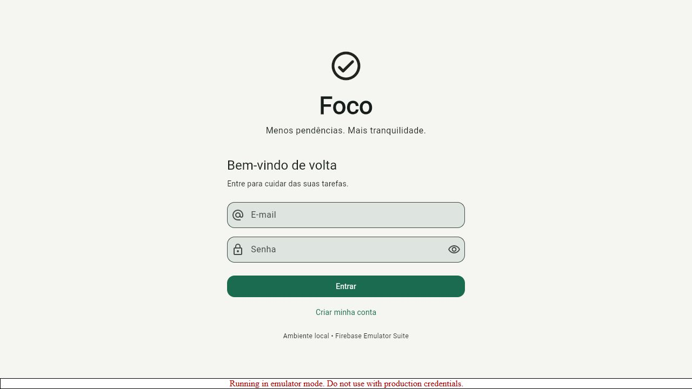
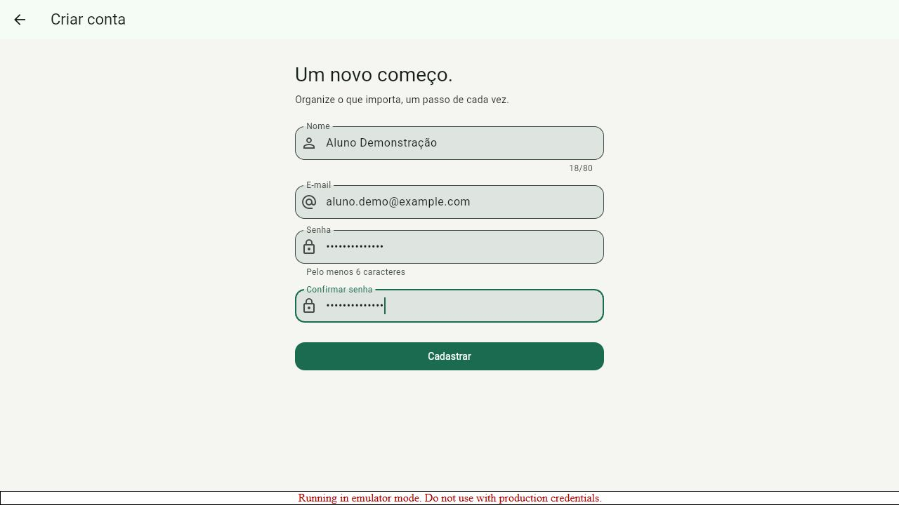
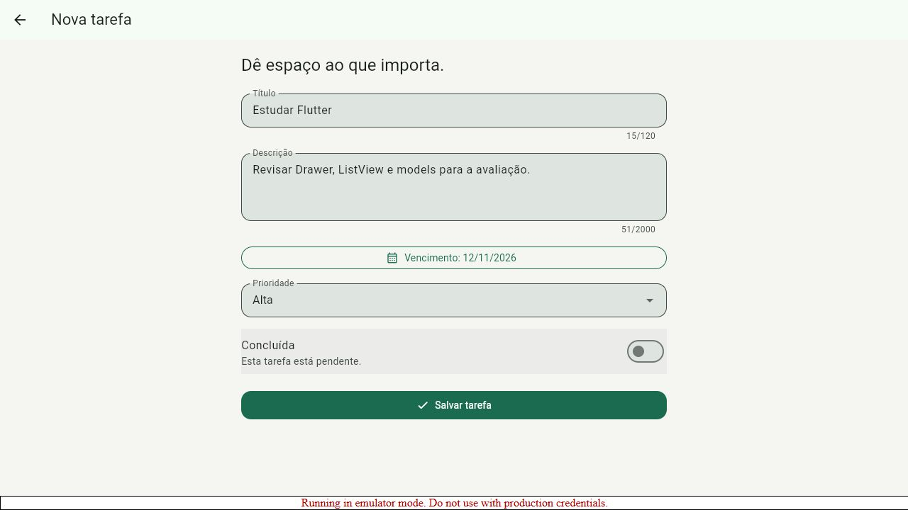
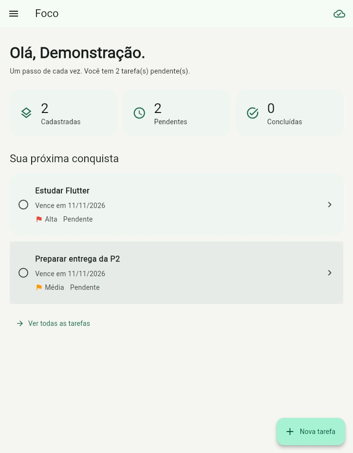
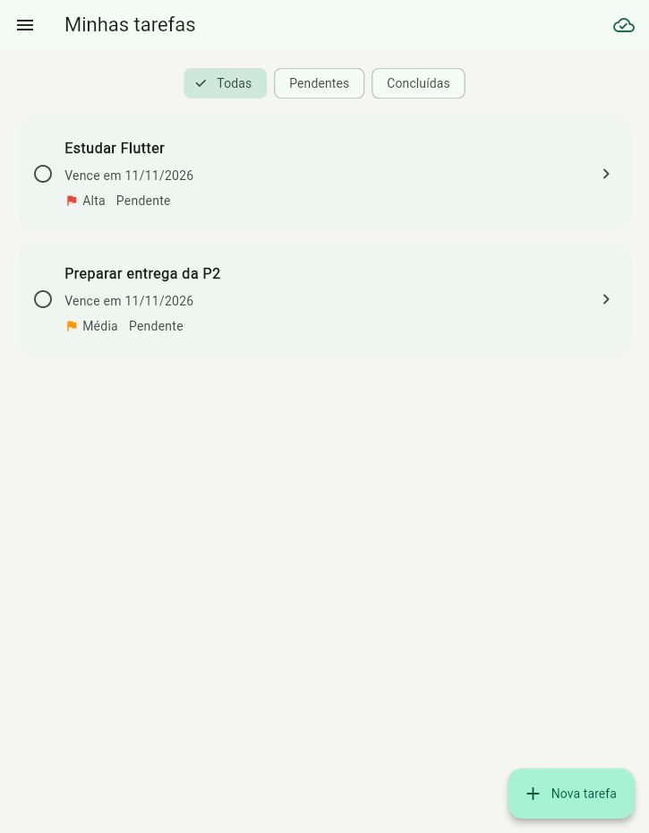
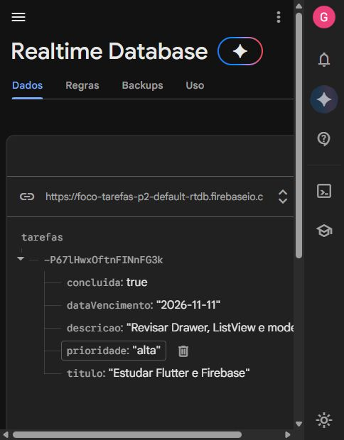
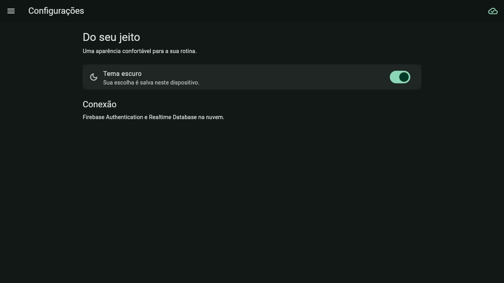
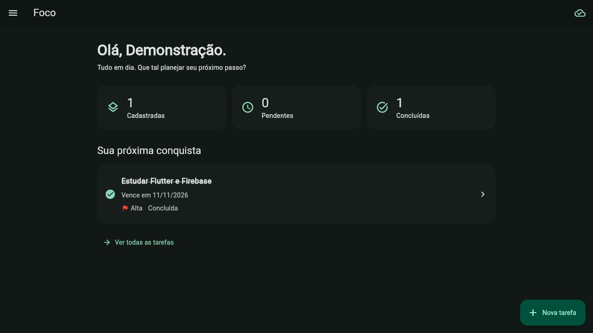

# Validação da entrega

Registro das verificações efetuadas em 11/11/2026. Projeto Firebase pessoal: **foco-tarefas-p2**, plano Spark. Aplicativos web e Android registrados; provedor e-mail/senha ativado; regras do Realtime Database publicadas.

| Verificação | Resultado |
|---|---|
| flutter analyze | Sem problemas encontrados |
| flutter test | 6 testes passaram: model, tema, validação, cadastro, edição, filtros |
| Regras Firebase no emulador oficial | 4 testes passaram: CRUD, isolamento, acesso anônimo, payload inválido |
| Build web release | Gerado com sucesso, incluindo recursos locais |
| Build Android debug | APK gerado com sucesso |
| Build Android release | APK conectado ao Firebase real gerado com sucesso (53,2 MB) |
| Cadastro real na interface Flutter web | Executado contra Firebase Emulator Suite |
| Cadastro de tarefa, prioridade e vencimento | Executado contra Firebase Emulator Suite |
| Capturas reais | Login, cadastro de usuário e cadastro de tarefa incluídos |
| Execução no VS Code | Sessão de depuração Foco - Firebase nuvem (web), usando Edge |
| Cadastro de usuário na nuvem | Conta fictícia de demonstração criada pela interface |
| Duas tarefas na nuvem | Criadas pela interface e conferidas no console Firebase |
| Edição e conclusão na nuvem | Título alterado e concluida=true conferidos no banco |
| Exclusão na nuvem | Somente a tarefa fictícia autorizada foi excluída; outra sessão refletiu a remoção |
| Sessão ao reabrir | Nova aba recuperou a conta autenticada e suas tarefas |
| Tema após reabrir | Tema escuro permaneceu após recarregar o app |
| Logout e novo login na nuvem | Login por e-mail/senha recuperou a tarefa editada; tema escuro preservado |

Os testes de interface automatizados usam um serviço de teste para verificar formulários e filtros. Os testes das regras usam Realtime Database real emulado. A integração com a nuvem também foi verificada pela interface web e pelo console Firebase. O Android foi compilado; **não foi executado em um celular ou Android Emulator**, pois nenhum dispositivo Android estava disponível nesta sessão. Antes de gravar no celular, instale o APK, cadastre sua conta e faça um ensaio.

## Critérios e implementação

| Critério | Arquivos principais |
|---|---|
| Authentication | services/auth_service.dart, screens/login_screen.dart, screens/cadastro_usuario_screen.dart |
| Drawer | widgets/drawer_menu.dart |
| Cadastro/ListView | screens/cadastro_tarefa_screen.dart, screens/tarefas_screen.dart |
| Models | models/usuario.dart, models/tarefa.dart |
| CRUD/listeners | services/firebase_service.dart, screens/detalhes_tarefa_screen.dart |
| Associação por UID | services/firebase_service.dart, database.rules.json |
| SharedPreferences | services/preferences_service.dart |
| Tema claro/escuro | themes/app_theme.dart, main.dart |

## Capturas

As imagens foram capturadas da aplicação Flutter em execução. As capturas 01 a 03 correspondem ao ambiente dos emuladores e são identificadas como tal na interface.

As capturas 04 em diante mostram a configuração e a execução com Firebase na nuvem. A conta utilizada é fictícia e seus dados servem apenas para validação; para gravar, cadastre sua própria conta de demonstração.

